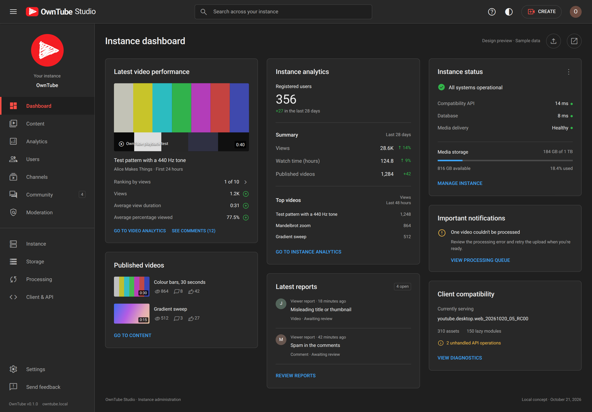
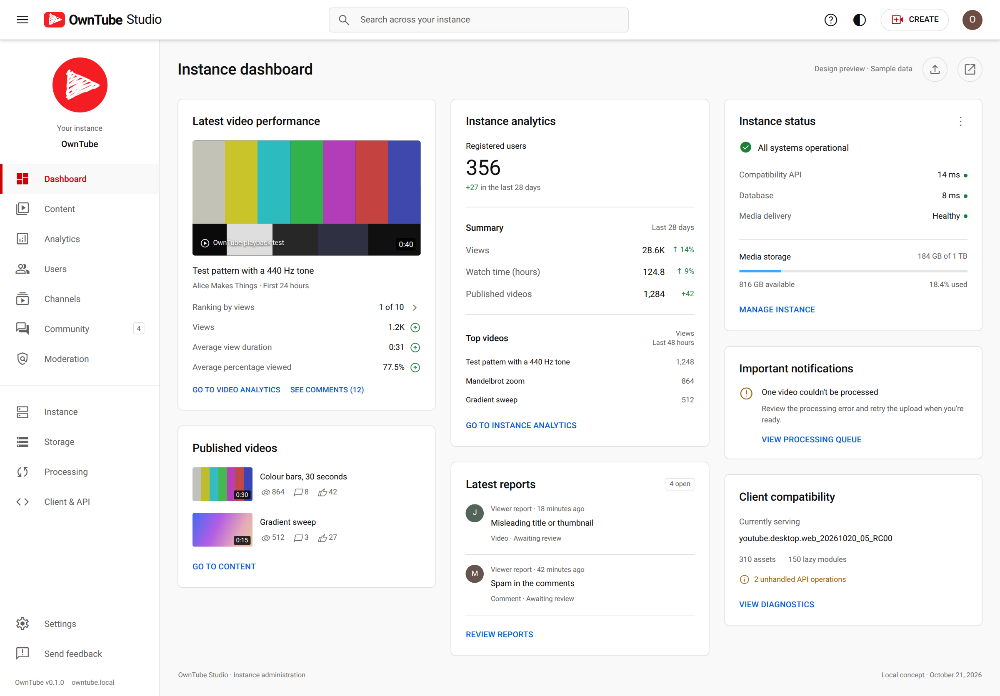

# OwnTube admin panel: design and implementation handoff

This is the visual baseline selected by the project owner for OwnTube's admin panel. Use it when implementing the panel and extend it with real, functioning features.

| Dark theme | Light theme |
| --- | --- |
|  |  |

## Open the design

Open [index.html](index.html) in a browser after cloning the repository, or serve the repository root locally:

```sh
python3 -m http.server 8000
```

Then visit http://localhost:8000/docs/admin-panel/.

The preview uses local fonts, the repository's OwnTube logo, and sample data. The Appearance button in the top bar has working Light theme, Dark theme, and Use device theme choices, with a browser-local saved preference. It does not need npm installation, an API server, a database, or an internet connection. Its buttons demonstrate layout and feedback; they are not production admin actions.

## Keep this design as the starting point

The owner asked for an admin interface that fits YouTube's visual language, after reviewing Xitter's admin panel. The selected version uses:

- Roboto text and Material Symbols Outlined icons.
- A 64 px top bar and a 256 px sidebar.
- Dark surfaces: `#1f1f1f` for the main workspace and `#282828` for the header, sidebar, and cards.
- Light surfaces: `#f9f9f9` for the workspace, white header/sidebar/cards, dark text, and appropriately darker links and status colors.
- Neutral borders, restrained 8 px card corners, and a consistent 24 px spacing rhythm.
- Red selection accents and OwnTube branding, with blue action links.
- A three-column desktop dashboard with readable, compact cards.
- Instance-wide controls, rather than assuming the operator owns only one creator channel.

Preserve the typography, icon family, colors, proportions, and general layout. Reuse the markup and styles where practical. Add new screens in this same design language rather than beginning a separate dashboard redesign.

This is a custom operator interface. The public OwnTube browsing and playback experience continues to use the actual YouTube web client.

## Appearance is a required feature

Support **Light theme**, **Dark theme**, and **Use device theme** for the finished panel.

When OwnTube's per-user appearance setting exists, use the same saved preference and active theme as the rest of the application. Entering or leaving the admin panel should not unexpectedly change appearance. Do not introduce a competing admin-only preference when the application already has one.

The preview's `owntube-admin-preview-appearance` localStorage key is a standalone demonstration adapter. Replace that adapter with the real application's preference store during integration. If the shared setting is not implemented yet, keep the preview's system-default and persisted explicit choices working, and document where the future integration belongs.

Requirements:

- Resolve the selected theme before the first paint to avoid a flash of the wrong background.
- A saved explicit light/dark choice overrides the device theme.
- Use device theme follows `prefers-color-scheme` and reacts to device changes while open.
- Persist user choices across reloads and navigation; use the shared account preference when available.
- Apply the theme to navigation, cards, controls, menus, dialogs, focus states, notifications, icons, text, and empty/error states.
- Preserve readable contrast in both palettes. Keep thumbnail/media colors and the OwnTube logo intact.
- Keep layout and functionality equivalent in both themes; verify narrow layouts in both.
- Handle unavailable browser storage and invalid/missing preferences gracefully.

## Start with the existing application

Inspect the current application before implementing: it may have advanced since this handoff was written.

At the time this reference was added, `src/admin.ts` was a route placeholder; `src/instance.ts` already called `adminRoutes(req, url, viewer)`, and `src/auth.ts` exposed the local viewer and its `isAdmin` property. `src/db.ts` handled PostgreSQL migrations.

Build on the current routing, authentication, database, media, and diagnostics code. Keep this directory as the reference; place production code with the application.

## Replace the sample behavior with actual features

Every hardcoded number, status, video, report, account, and build value in the preview is sample content. Replace the demo toast handlers with working routes, API operations, and persisted state. The sample figures are not evidence of implemented functionality.

### Dashboard and analytics

- Query actual users, channels, published videos, views, and storage usage.
- Use clearly defined time windows for totals and comparison figures.
- Populate recent videos and top-video lists from the database.
- Show unknown or unavailable analytics honestly until the necessary measurements exist.
- Fetch actual processing errors, service status, and diagnostics.
- Include working loading, empty, and error states.

### Content and processing

- Add a searchable, paginated content list with useful visibility and processing-status filters.
- Open a video's real watch page and details from its row.
- Connect upload actions to the actual upload/processing pipeline.
- Support metadata edits and authorized visibility changes.
- Display processing progress and failures; retry through the existing job system.
- Confirm destructive actions and clean up associated files consistently.
- Keep private and unlisted media rules consistent with the public backend.

### Users and channels

- List and search local accounts and channels.
- Display real account/channel details and content.
- Implement only moderation and account actions that the backend actually supports.
- Persist changes and refresh affected views after success.
- Add staff roles only when supported by a defined permission model; the preview does not grant permissions.

### Community and moderation

- Build report collection and storage if they are not yet implemented.
- Show reported objects, reasons, timestamps, and review status.
- Link to the affected content or account.
- Implement review decisions, supported sanctions, and an audit trail.
- Make the report count reflect unresolved reports rather than a static badge.

### Instance, storage, and client compatibility

- Read real configuration and validate changes before saving.
- Calculate media usage from the actual storage system.
- Show worker and database health without making public visitors able to access operator diagnostics.
- Read build and asset information from the actual pin.
- List unhandled operations and processing failures from the real diagnostic sources.
- Treat client updates or rollback as explicit operations and only offer them once safely implemented.
- Connect Settings, feedback/help destinations, search, and every sidebar entry to a meaningful screen or explicitly mark unavailable features.

## Authorization and reliability

Enforce operator authorization on the server for both admin pages and every admin API operation. Use the application's session and request-validation mechanisms; hiding a button is not an access check.

Validate inputs, paginate large datasets, avoid returning secrets in diagnostic responses, and record meaningful administrative changes. Require confirmation for destructive operations. A failed mutation must keep its error visible and must not display a fake success state.

Keep the existing public client and playback routes working while introducing admin routes.

## Validate the finished implementation

Use a fresh development database and real browser interactions. At minimum, verify:

1. Anonymous and ordinary accounts cannot load admin data or perform mutations.
2. An authorized operator can navigate every implemented sidebar page.
3. Dashboard figures match the database and storage.
4. Uploads proceed through processing to playable local videos.
5. Content/account changes persist after reload and server restart.
6. Moderation decisions and retry actions affect actual records or jobs.
7. Loading, empty, invalid-input, unauthorized, and failure states render clearly.
8. The interface remains usable on narrow windows without clipped action buttons.
9. The desktop rendering still matches this reference's design.
10. Light/dark selection persists, follows the shared user preference, and device changes update only the system setting.
11. Both palettes have readable text, controls, status indicators, thumbnails, and dialogs without a wrong-theme flash.
12. The public official client still boots and plays local videos.

Capture updated screenshots and record what works. Do not report the static preview or working toast messages as a completed admin panel.

## Reference files and asset provenance

| File | Purpose |
| --- | --- |
| `index.html` | Editable HTML/CSS/JavaScript design source |
| `preview.png` | Dark-theme desktop screenshot |
| `preview-light.png` | Light-theme desktop screenshot |
| `assets/fonts.css` | Local font declarations |
| `assets/fonts/` | Roboto Latin 400/500/700 and Material Symbols Outlined |
| `../images/owntube-logo.png` | OwnTube's widened white scribble triangle logo |

Roboto files were obtained from `@fontsource/roboto@5.3.0`. Material Symbols were obtained from `@material-symbols/font-400@0.48.1`. Their license notices are included in `assets/LICENSE-Roboto.txt` and `assets/LICENSE-Material-Symbols.txt`.

Architecture references: [Xitter admin source](https://github.com/Xittered/xitter/blob/main/src/admin.html), [Xitter](https://github.com/Xittered/xitter), and [Meowcord](https://github.com/meowcorded/meowcord/).
